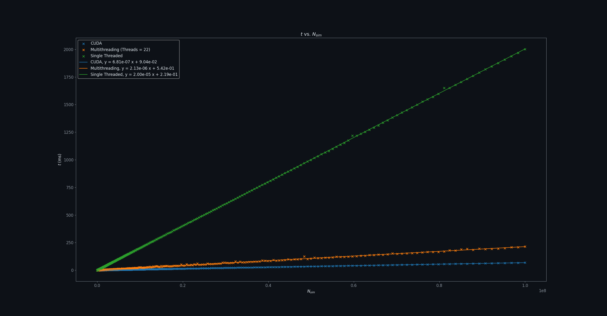
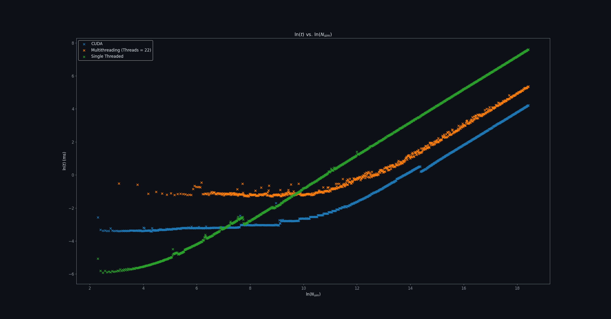
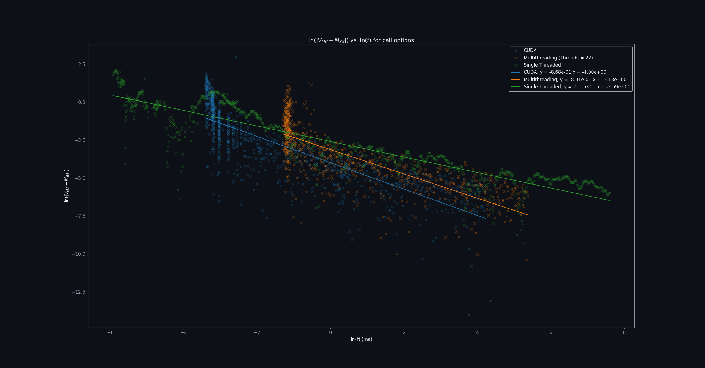
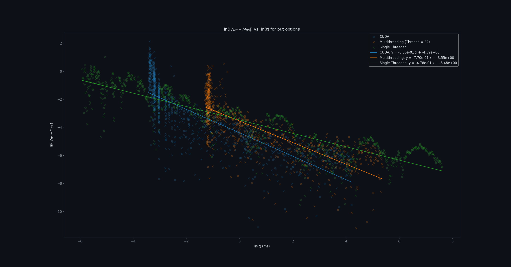

# Speedy-Carlo: CUDA-accelerated and Multithreaded Monte Carlo Simulations
This repository is dedicated to making my pre-existing Monte Carlo simulations for option pricing even faster. Successfully made my simulations **29.4x** faster with CUDA and **9.4x** faster with Multithreading
## Directory Structure
```text
speedy-carlo/
├── README.md
├── LICENSE
├── data/
|  ├── CUDA_data.csv
|  ├── MT_data.csv
|  ├── ST_data.csv
├── exp/
|  ├── CUDA_experiment.cu
|  ├── MT_experiment.cu
|  ├── ST_experiment.cu
├── img/
|  ├── calls_convergence.png
|  ├── log_calls_convergence.png
|  ├── log_puts_convergence.png
|  ├── log_time_evolution.png
|  ├── puts_convergence.png
|  ├── time_evolution.png
├── src/
|  ├── GPU_monte_carlo.cu
|  ├── CPU_MT_monte_carlo.cpp
|  ├── CPU_ST_monte_carlo.cpp
├── vis/
|  ├── convergence_runtime_calls.py
|  ├── convergence_runtime_puts.py
|  ├── log_convergence_runtime_calls.py
|  ├── log_convergence_runtime_puts.py
|  ├── log_time_evolution.py
|  ├── time_evolution.py
```
## Build
For the **CUDA C++** files I compiled it like this:
```bash
nvcc -O3 -gencode=arch=compute_89,code=sm_89 file.cu -o exec.out
```
For the single-threaded and multi-threaded **C++** files I compiled it like this;
```bash
g++ -O3 -std=c++20 -pthread file.cpp -o exec.out
```

In order to execute these files use (after each compilation you want to execute it):
```bash
./exec.out
```
## Specifications of Equipment
- GPU Architecture (NVIDIA GeForce RTX 4070 Max-Q)
  - 36 Streaming Multiprocessors
  - 4608 CUDA Cores
  - 32 Threads per Block
    
- CPU Architecture (Intel(R) Core(TM) Ultra 9)
  - 6 Performance Cores
  - 8 Efficient Cores
  - 2 Low-Power Efficient Cores
  - 16 Total Physical Cores
  - 22 Logical Threads
  - x86-64 Architecture
 
## Results
### Time Evolution 

### Log-Time Evolution

### Convergence-Time Graph for Calls

### Log-Convergence-Time Graph for Calls

### Convergence-Time Graph for Puts

### Log-Convergence-Time Graph for Puts

